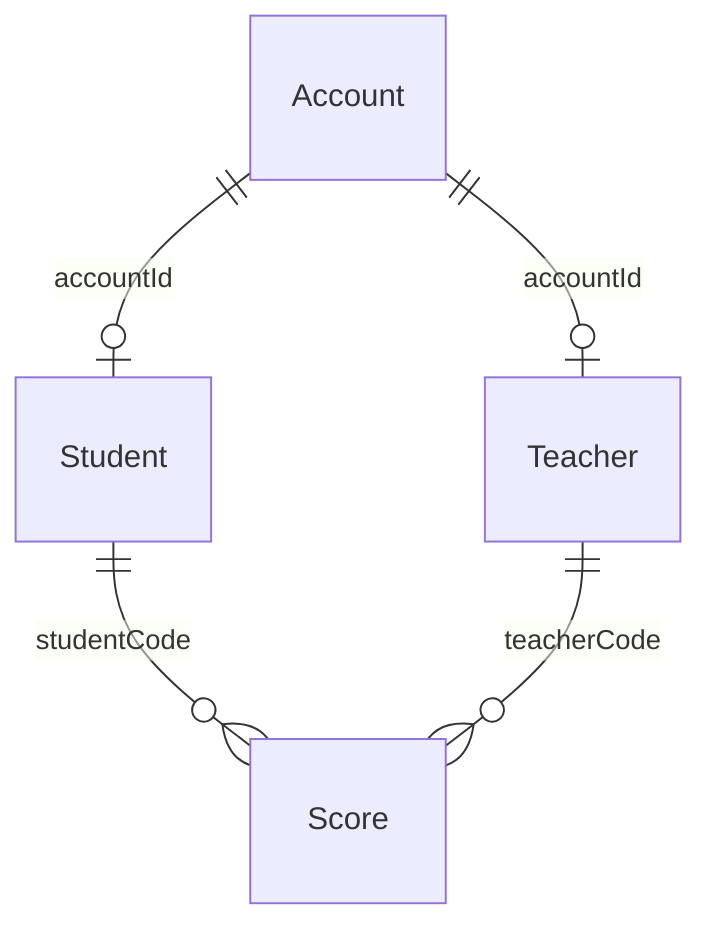

# Sổ điểm — StudentManager

Bài tập môn **Thiết kế ứng dụng di động**. Ứng dụng Android native viết bằng **Java + XML**, lưu dữ liệu bằng **SQLite**, có hai vai trò **giáo viên** và **sinh viên**.

## Mở và chạy

1. Android Studio → **Open** → chọn thư mục `StudentManager` có file `settings.gradle.kts`.
2. Chọn **Gradle JDK 21** (có thể dùng JBR đi kèm Android Studio).
3. Cài Android SDK Platform **36.1** nếu máy chưa có. Gradle Wrapper và phiên bản thư viện đã được cố định trong project.
4. Chờ Gradle Sync, chọn emulator hoặc điện thoại Android **7.0/API 24 trở lên**, sau đó nhấn **Run app**.

Lần sync đầu cần mạng để tải dependency; ứng dụng sau khi cài **không cần mạng**.

Build bằng PowerShell trên máy hiện tại:

```powershell
$env:JAVA_HOME = "$env:LOCALAPPDATA\Programs\Android Studio\jbr"
.\gradlew.bat :app:assembleDebug :app:testDebugUnitTest :app:lintDebug
```

APK: `app/build/outputs/apk/debug/app-debug.apk`. Bản bàn giao có tên dễ nhận biết nằm tại `artifacts/StudentManager-debug.apk` sau khi chạy script đóng gói.

Đóng gói APK, mã nguồn ZIP và SHA-256 (chạy `git add .` để đưa các file nguồn mới vào danh sách đóng gói trước):

```powershell
.\tools\package.ps1
```

## Tài khoản mẫu

| Vai trò | Tài khoản | Mật khẩu |
|---|---|---|
| Giáo viên Nguyễn Minh Anh | `teacher01` | `teacher123` |
| Giáo viên Trần Hoàng Nam | `teacher02` | `teacher123` |
| Sinh viên SV001 — Lê Thu Hà | `student01` | `student123` |
| Sinh viên SV002 — Phạm Đức Huy | `student02` | `student123` |
| Sinh viên SV003 — Võ Khánh Linh | `student03` | `student123` |

Dữ liệu mẫu gồm 2 giáo viên, 3 sinh viên, 6 bản ghi điểm. Chỉ khởi tạo khi SQLite tạo database lần đầu; mở lại ứng dụng không ghi đè dữ liệu đang có. Mật khẩu mẫu phục vụ trình diễn bài tập.

## Chức năng

**Giáo viên**

- Đăng nhập, xem tổng số sinh viên và số bản ghi điểm do mình nhập.
- Tìm sinh viên theo mã, họ tên hoặc email.
- Thêm sinh viên và tài khoản đăng nhập trong cùng một transaction.
- Sửa họ tên/email; mã sinh viên và tài khoản giữ nguyên.
- Xóa sinh viên chưa có điểm, đồng thời xóa tài khoản liên kết. Nếu có điểm của bất kỳ giáo viên nào, thao tác bị từ chối.
- Xem, nhập, sửa và xóa điểm **do chính mình nhập**; lọc theo môn/mã/tên sinh viên.

**Sinh viên**

- Đăng nhập, xem thông tin của mình và trung bình cộng các bản ghi điểm đã có (không có trọng số/tín chỉ).
- Xem điểm của mình từ các giáo viên; tìm theo môn học.
- Không có quyền ghi dữ liệu hoặc đọc danh sách điểm của người khác.

**Phiên đăng nhập**

- Chọn ghi nhớ: SharedPreferences lưu `accountId`, `username`, `role`, `remember`.
- Không chọn ghi nhớ: phiên chỉ tồn tại trong bộ nhớ tiến trình. Khi tiến trình bị kết thúc, cần đăng nhập lại.
- Khôi phục phiên luôn kiểm tra tài khoản/vai trò thật trong SQLite. Giá trị `role` lưu trong preferences không được dùng để cấp quyền.
- Đăng xuất xóa phiên và toàn bộ back stack; nút Back không quay lại màn hình đã đăng nhập.

## Mô hình dữ liệu

Giữ đúng 4 tên bảng và các thuộc tính trong ảnh đề bài:

```text
Account(id, username, password, role)
Student(id, code, fullname, email, accountId)
Teacher(id, fullname, email, accountId)
Score(id, studentCode, teacherCode, subject, score)
```



- `Account.id`, `Student.id`, `Teacher.id`, `Score.id`: khóa chính số nguyên tự tăng.
- `Account.username` và `Student.code`: duy nhất, so sánh không phân biệt hoa/thường.
- `Student.accountId`, `Teacher.accountId`: khóa ngoại duy nhất tới `Account.id`.
- `Score.studentCode`: khóa ngoại tới `Student.code`.
- **Quy ước quan trọng:** ví dụ đề có `Score.teacherCode` nhưng không có `Teacher.code`. Project giữ tên `teacherCode`, dùng kiểu INTEGER và liên kết tới **`Teacher.id`**, không tự ý thêm thuộc tính vào bảng Teacher.
- `Score.score`: số thực từ 0 đến 10, có kiểm tra ở repository và SQLite.
- Một sinh viên có tối đa một điểm cho mỗi tổ hợp **giáo viên + môn học**. Môn được loại bỏ khoảng trắng ở hai đầu, so sánh NOCASE của SQLite (hoa/thường ASCII).
- Khóa ngoại được bật trong `onConfigure`; xóa dữ liệu liên kết được kiểm soát bằng transaction và `ON DELETE RESTRICT`.
- `Account.password` chứa chuỗi `iterations:salt:hash`: PBKDF2-HMAC-SHA1, 120.000 vòng, salt ngẫu nhiên 16 byte, đầu ra 256 bit. Không lưu mật khẩu thô trong database hoặc SharedPreferences.

Tên database: `student_manager.db`, phiên bản schema: 1. Phiên bản sau cần migration rõ ràng, không tự drop bảng để nâng cấp.

## Tổ chức mã nguồn và luồng xử lý

```text
com.example.studentmanager
├── StudentManagerApp.java       # Repository, executor SQLite, phiên ứng dụng
├── MainActivity.java            # Trang chính theo vai trò
├── activities/
│   ├── LoginActivity.java
│   ├── StudentActivity.java
│   ├── ScoreActivity.java
│   ├── BaseActivity.java        # Async, phiên, toolbar, insets hệ thống
│   ├── RecordListActivity.java
│   └── RecordAdapter.java
├── dal/
│   ├── DBHelper.java            # Schema và seed một lần
│   ├── StudentRepository.java   # CRUD, transaction, kiểm tra quyền
│   └── PasswordHasher.java
├── models/                     # Account, Student, Teacher, Score
└── session/
    └── SessionManager.java      # SharedPreferences và phiên trong bộ nhớ
```

Luồng: **Activity → executor nền → StudentRepository → DBHelper/SQLite → main thread cập nhật giao diện**. Hash/kiểm tra mật khẩu và truy vấn dữ liệu không chạy trên main thread. Quyền của giáo viên được tra từ SQLite theo ID tài khoản; truy vấn điểm được giới hạn theo chủ sở hữu, không chỉ ẩn nút sửa/xóa.

Không có API mạng/backend. AndroidManifest không yêu cầu quyền Internet. Mỗi bản cài có dữ liệu riêng; nhiều thiết bị không tự đồng bộ với nhau.

## Kiểm thử

```powershell
# Unit test và kiểm tra tĩnh
.\gradlew.bat :app:testDebugUnitTest :app:lintDebug

# Bật emulator/điện thoại trước khi chạy
.\gradlew.bat :app:connectedDebugAndroidTest
```

- Unit test: xác thực mật khẩu Unicode/khoảng trắng, salt độc lập, chuỗi hash lỗi.
- Kiểm thử repository: đăng nhập, phân quyền, không sửa điểm người khác, transaction và rollback, CRUD, dữ liệu trùng, điểm biên 0/10, NaN/Infinity, sinh viên đã có điểm, bảo toàn dữ liệu sau mở lại database.
- Kiểm thử phiên: ghi nhớ/không ghi nhớ, chuyển lựa chọn ghi nhớ và đăng xuất.
- Kiểm thử giao diện: đăng nhập sai, giáo viên lọc sinh viên, sinh viên chỉ thấy điểm của mình và không có nút sửa.
- Database kiểm thử repository và SharedPreferences kiểm thử phiên dùng tên/context riêng, không sửa dữ liệu người dùng của ứng dụng.

Báo cáo Gradle ở `app/build/reports/`. Kết quả kiểm tra thực tế của bản bàn giao được ghi tại `docs/VERIFICATION.md`.

## Kịch bản demo khoảng 5 phút

1. Đăng nhập sai để trình diễn thông báo; đăng nhập `teacher01`.
2. Mở danh sách sinh viên, tìm `SV001`.
3. Thêm `SV004`, tài khoản `student04`, mật khẩu ít nhất 6 ký tự; sửa email của sinh viên vừa thêm.
4. Nhập điểm một môn cho `SV004`; thử nhập 11 để thấy kiểm tra dữ liệu, sau đó lưu 8.5.
5. Thử nhập trùng môn/sinh viên; thử xóa sinh viên đang có điểm.
6. Đăng xuất; đăng nhập `student04`, kiểm tra chỉ có điểm của mình và không có chức năng chỉnh sửa.
7. Đăng nhập `teacher02`: không thấy điểm do `teacher01` nhập trong danh sách quản lý của mình.
8. Đăng nhập với ghi nhớ, đóng/mở lại tiến trình để kiểm tra khôi phục. Đăng xuất rồi nhấn Back để kiểm tra phiên đã kết thúc.

## Đối chiếu yêu cầu và giả định

| Nội dung ảnh đề | Cách đáp ứng |
|---|---|
| Đăng nhập 2 vai trò | Giáo viên và sinh viên, kiểm tra quyền tại repository |
| SharedPreferences | Ghi nhớ thông tin/phiên đăng nhập |
| SQLite hoặc Room | SQLiteOpenHelper + SQLite |
| GitHub hoặc GitLab | Project Git có `.gitignore`; cần đưa lên repository của nhóm |
| Các bảng và thuộc tính | Giữ 4 bảng trong ví dụ, giải thích `teacherCode` ở trên |

Ảnh gọi 4 bảng là **ví dụ**, chưa xác nhận đó là đề chính thức của nhóm. Việc chọn bộ bảng này, vai trò, các quyền CRUD và giao diện tiếng Việt là giả định đã dùng theo kế hoạch triển khai. Bài không bổ sung đăng ký công khai, quản trị viên, quản lý môn học bằng bảng riêng hay đồng bộ server.

## Đưa lên GitHub

Repository local đã được chuẩn bị. Tạo một repository trống thuộc nhóm, rồi dùng URL thật:

```powershell
git add .
git commit -m "Build Android student manager with SQLite and role based access"
git remote add origin URL_REPOSITORY_CUA_NHOM
git branch -M main
git push -u origin main
```

`local.properties`, APK/build output, dữ liệu emulator, cache và khóa ký nằm trong `.gitignore`. Chia sẻ APK qua phần Releases hoặc file bàn giao; không cần đưa toàn bộ output build vào Git.
