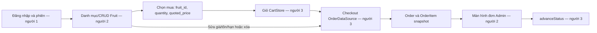

# Người 2 — nghiệp vụ trái cây và màn hình Admin

Tài liệu này mô tả phần người 2 trên nền `com.example.fruitshop` của người 1. Hợp đồng dữ liệu dùng chung nằm trong [HANDOFF.md](HANDOFF.md). Đề gốc có bốn bảng; bản nhóm đã mở rộng `Fruit.unit` và `OrderItem` để bán theo kg/quả/phần và giữ chi tiết đơn hàng.

## 1. Ranh giới trách nhiệm

| Thành phần | Người 2 thực hiện | Liên quan đến người khác |
| --- | --- | --- |
| Danh mục trái cây | `FruitRepository` triển khai `FruitDataSource`; `FruitCatalogActivity` hiển thị, tìm kiếm và xem chi tiết | Người 1 cung cấp schema/model/đăng nhập; người 3 mở danh mục từ trang Customer |
| Quản lý trái cây | Admin thêm, sửa, xóa; kiểm tra giá, tồn, ngày và đơn vị | Người 1 giữ `DBHelper` và các quy tắc dùng chung |
| Chọn mua | Customer nhập số lượng và nhận dữ liệu mặt hàng đã xem | Người 3 thêm vào `CartStore`, checkout và trừ tồn |
| Quản lý đơn phía Admin | `AdminOrdersActivity` hiển thị đơn, chi tiết và nút chuyển trạng thái | Người 3 triển khai `OrderDataSource`; người 1 nối repository vào `FruitShopApp` |

Người 2 không tạo database, model hoặc hàm checkout khác. `FruitRepository` dùng `DBHelper`, `AuthRepository`, `BusinessDates`, `Quantities` và `Money` của nền chung.

## 2. Quy tắc dữ liệu và quyền

- Tất cả hàm của `FruitRepository` nhận `actorAccountId` từ phiên đã xác minh. Repository gọi `AuthRepository.accountById` hoặc `requireAdmin`; quyền không lấy từ nút bấm, `Intent` hay SharedPreferences.
- Admin xem cả hàng còn bán, hết hạn và hết tồn. Customer chỉ thấy hàng có `quantity > 0` và `expiryDate >= ngày hôm nay`; mở chi tiết hàng không còn bán trả `NOT_FOUND`.
- `price` là số nguyên VND trên một đơn vị bán và phải lớn hơn 0. `quantity` lưu bằng gram nguyên cho `KG`, số nguyên cho `PIECE`/`PACK`; tồn bằng 0 được phép để Admin quản lý hàng hết kho.
- Hạn dùng phải là ngày thực theo `YYYY-MM-DD`. Ngày bằng hôm nay vẫn bán được; ngày trước hôm nay là hết hạn. `BusinessClock` dùng múi giờ thiết bị và có thể thay bằng đồng hồ cố định trong kiểm thử.
- `unit` không đổi sau khi tạo. Đổi đơn vị sẽ khiến số tồn và giá cũ bị hiểu sai; repository kiểm tra trước khi cập nhật, schema cũng có trigger bảo vệ.
- Tên và danh mục bắt buộc, tối đa lần lượt 100 và 80 ký tự; mô tả tối đa 1.000 ký tự. Dữ liệu sai trả `DomainException(INVALID_INPUT)`.

## 3. Từng nghiệp vụ trái cây

### 3.1 Xem danh mục và tìm kiếm

`FruitCatalogActivity` gọi `FruitDataSource.list(actorAccountId, query)` trên `databaseExecutor`. Query rỗng trả toàn bộ mặt hàng mà vai trò được xem. Tìm theo **tên hoặc danh mục**, không phân biệt hoa/thường; mô tả không nằm trong điều kiện tìm. Danh sách của Admin ghi rõ giá, tồn và trạng thái **Còn hàng / Hết hàng / Hết hạn**. Danh sách của Customer chỉ chứa mặt hàng đang có thể bán, vẫn hiển thị hạn dùng để khách kiểm tra.

Khi mở một dòng, màn hình gọi lại `detail` để lấy bản ghi mới nhất. Việc lọc ở giao diện phục vụ trải nghiệm; kiểm tra quyền và điều kiện còn bán nằm trong repository.

### 3.2 Thêm trái cây — Admin

Admin nhập tên, danh mục, đơn vị, giá, tồn, hạn dùng và mô tả. Form đổi số kg sang **gram nguyên** bằng `Quantities.parse`; quả/phần chỉ nhận số nguyên. `FruitRepository.create` kiểm tra quyền Admin và toàn bộ dữ liệu rồi insert vào bảng `Fruit` trong transaction. Admin có thể lưu mặt hàng đã hết hạn hoặc tồn bằng 0 để theo dõi kho, nhưng Customer sẽ không nhìn thấy mặt hàng đó.

Giá và tồn không được âm hoặc tràn phạm vi `long`; giá bằng 0 không hợp lệ. Ngày như `2026-02-30` bị từ chối dù đúng khuôn dạng chữ.

### 3.3 Sửa trái cây — Admin

`update` kiểm tra Admin, đọc bản ghi hiện tại và giữ nguyên `unit`. Admin có thể đổi tên, danh mục, giá, tồn, hạn và mô tả. Màn hình nạp lại danh mục sau khi lưu.

Thay đổi giá hoặc tồn có thể làm giỏ cũ không còn phù hợp. Người 3 phải đọc lại các giá trị này khi checkout: giá lệch thì yêu cầu khách xác nhận lại; hết hạn/hết tồn/quá tồn thì không tạo đơn. Các dòng `OrderItem` đã mua là snapshot nên không thay đổi theo Fruit.

### 3.4 Xóa trái cây — Admin

`delete` kiểm tra Admin rồi xóa bản ghi `Fruit` trong transaction. Khóa ngoại `OrderItem.fruitId ON DELETE SET NULL` chỉ bỏ liên kết đến mặt hàng; `fruitName`, `unit`, `unitPrice`, `quantity`, `lineTotal` của đơn cũ vẫn giữ nguyên. Nếu Customer còn mặt hàng này trong giỏ, checkout của người 3 phải báo không tìm thấy và không tạo đơn/trừ tồn.

### 3.5 Chọn mua — Customer

Customer mở chi tiết và nhập lượng mua: `KG` tối đa ba chữ số thập phân (nhận dấu chấm hoặc phẩy), `PIECE`/`PACK` là số nguyên dương. Trước khi trả lựa chọn, màn hình đọc lại `detail`, kiểm tra tồn và so giá vừa xem. Hàng hết hạn/hết kho biến mất khỏi chi tiết Customer; giá vừa đổi yêu cầu khách đóng hộp thoại và xem lại.

Khi hợp lệ, Activity trả `RESULT_OK` với ba `long` extras:

| Extra | Ý nghĩa |
| --- | --- |
| `fruit_id` | ID mặt hàng |
| `quantity` | Lượng theo đơn vị cơ sở: gram hoặc số quả/phần |
| `quoted_price` | Giá VND/đơn vị khách vừa xem |

Màn hình này **chưa đặt đơn và chưa trừ tồn**. Người 3 tạo `CartLine(fruitId, quantity, quotedUnitPrice)` và gọi `CartStore.add`. Checkout kiểm tra lại quyền, giá, hạn và tồn trong một transaction vì dữ liệu có thể thay đổi sau lúc chọn mua.

## 4. Đơn hàng và trạng thái phía Admin

`AdminOrdersActivity` chỉ nhận vai trò `ADMIN` qua `BaseActivity.requiredRole()`. Màn hình gọi `OrderDataSource.list` để lấy đơn, `detail` để hiển thị từng dòng snapshot, và `advanceStatus` khi Admin bấm chuyển trạng thái. Nút chỉ đề xuất chiều `PENDING → CONFIRMED → COMPLETED`; đơn `COMPLETED` không có nút chuyển tiếp.

`OrderDataSource` của người 3 là nơi kiểm tra lại quyền Admin và trạng thái hiện tại, kể cả khi màn hình hiển thị dữ liệu cũ. Chuyển trạng thái không trừ tồn lần nữa; tồn đã được trừ khi `place` thành công. Nếu đơn bị đổi trạng thái bởi thao tác khác, repository trả `INVALID_STATUS`; Admin có thể mở lại màn hình để tải dữ liệu mới.

Hiện repository đơn của người 3 chưa có trong checkout này. `AdminOrdersActivity` đã biên dịch theo interface, nhưng nút **Quản lý đơn hàng** trên AdminHome chỉ hiện khi `FruitShopApp` triển khai `AdminOrdersActivity.OrderProvider` và trả `OrderDataSource` thật. Người 1 thực hiện điểm nối này khi tích hợp; màn hình không dùng dữ liệu giả.

## 5. Quan hệ giữa các luồng

Các quan hệ quan trọng:

1. **Tài khoản → quyền:** người 1 xác minh phiên; người 2 kiểm tra lại quyền trong `FruitRepository`; người 3 kiểm tra quyền trong `OrderDataSource`.
2. **Fruit → giỏ → đơn:** dữ liệu trong giỏ là lựa chọn và giá đã xem, không phải giá/tồn chính thức. Checkout dùng bản ghi Fruit mới nhất.
3. **Fruit → lịch sử:** đơn lưu snapshot trong `OrderItem`, nên sửa/xóa Fruit không sửa lịch sử.
4. **Đặt đơn → trạng thái:** `place` trừ tồn một lần; `advanceStatus` chỉ đổi trạng thái.

## 6. Điểm nối và kiểm thử

- Hai Activity mới đã được đăng ký trong manifest; AdminHome mở danh mục. `CustomerHomeActivity` thuộc người 3, cần mở `FruitCatalogActivity` bằng Activity Result API và xử lý ba extra ở mục 3.5.
- `FruitRepositoryInstrumentedTest` dùng `DBHelper` thật với database thử và đồng hồ cố định để kiểm tra CRUD, quyền, tìm kiếm, hết hạn/hết tồn, dữ liệu không hợp lệ và snapshot sau khi xóa. Test Android đã biên dịch; cần emulator/thiết bị để chạy.
- Build APK, unit test và lint đã chạy thành công ở trạng thái hiện tại. Lint có 0 lỗi; các cảnh báo còn lại thuộc cấu hình/tài nguyên nền.
